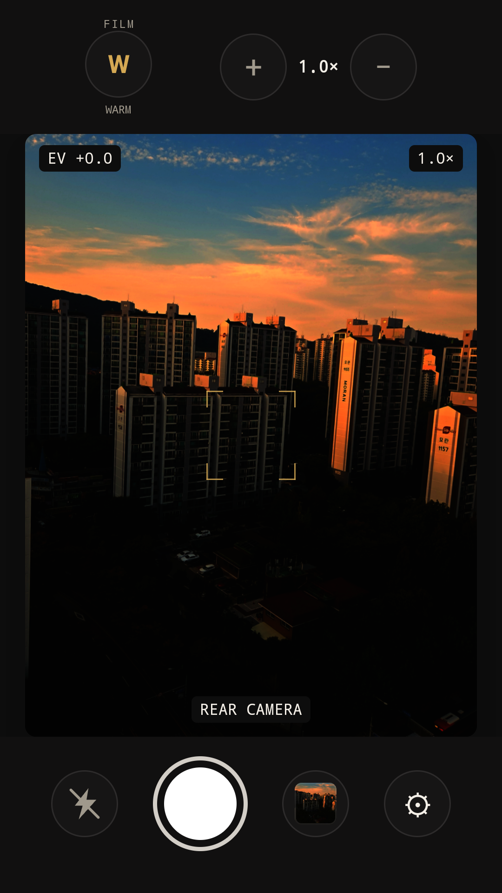
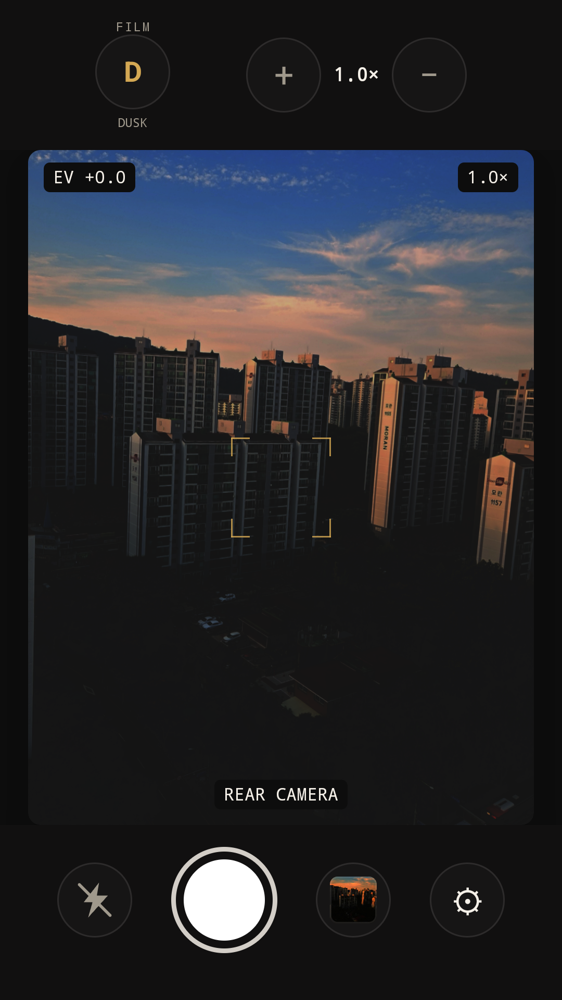
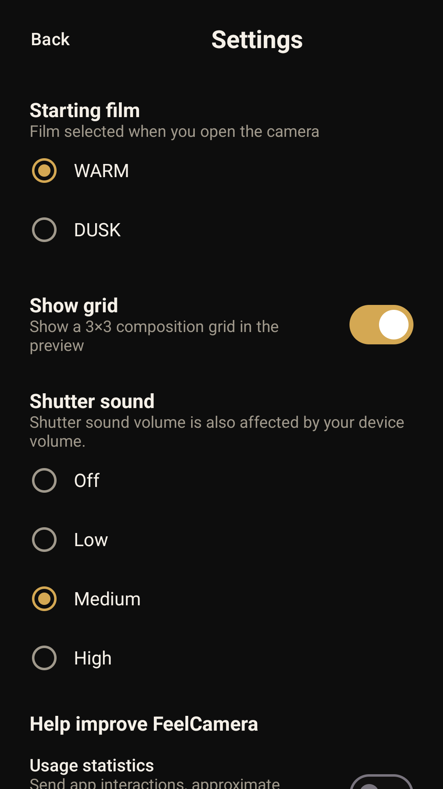
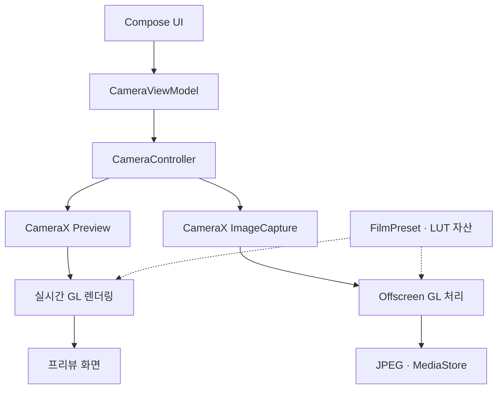

# FeelCamera 📷

**촬영 전에 필름의 색감을 고르고, 그 선택을 사진으로 남기는 Android 카메라 앱.**

WARM·DUSK 필름을 실시간 프리뷰와 저장 사진에 적용합니다. 개발하며 가장 오래 고민한 것은 **기기를 돌려도 촬영 구도를 유지하면서, 실제 창 크기가 바뀌는 큰 화면에도 대응하는 방법**이었습니다. 촬영 순간의 필름 선택과 카메라 자원의 수명도 별도의 문제로 다뤘습니다.

`Kotlin` · `Jetpack Compose` · `CameraX` · `OpenGL ES 3.0` · `Coroutines` · `Hilt` · `DataStore`

**Google Play:** 출시 준비 중 · 배포 후 이 자리에 앱 페이지 링크를 연결할 예정입니다.

<table>
  <tr><th>WARM 화면 소개</th><th>DUSK 화면 소개</th><th>촬영 설정</th></tr>
  <tr>
    <td></td>
    <td></td>
    <td></td>
  </tr>
</table>

Google Play 스토어용 소개 이미지입니다. WARM·DUSK 화면은 에뮬레이터에서 캡처한 앱 UI의 프리뷰 영역에 직접 촬영한 사진을 합성했습니다. UI 캡처 기준은 1.0.3 (4)이며, 현재 코드의 버전과는 차이가 있습니다. [이미지 제작 방식](design/play-store/README.md)

## 목차

- [프로젝트 소개](#프로젝트-소개)
- [핵심 구현](#핵심-구현)
- [처리 구조](#처리-구조)
- [문제 해결](#문제-해결)
- [기술·제품 판단](#기술제품-판단)
- [개발 과정과 AI 활용](#개발-과정과-ai-활용)
- [검증과 빌드](#검증과-빌드)
- [배운 점](#배운-점)
- [상세 문서](#상세-문서)

## 프로젝트 소개

**촬영 화면에서 고른 필름이 저장 사진에도 이어져야 한다**는 목표로 시작했습니다. CameraX·Compose·OpenGL ES를 학습하면서 후면 카메라 입력부터 필터 처리, JPEG 저장까지 한 번에 연결하는 앱을 만들었습니다. Android 17의 큰 화면 방향 정책을 계기로 휴대폰과 태블릿·폴더블의 화면 전략도 다시 검토했습니다.

기본 촬영과 저장을 먼저 완성하고 필터·회전·설정을 확장했습니다. 요구사항과 우선순위를 정하고, 카메라·렌더링·UI를 연결했으며, 자동 테스트와 직접 실기기 확인을 통해 결과를 점검했습니다. [개발 배경과 작업 기록](docs/portfolio/product-and-development.md)

| 항목 | 현재 범위 |
| --- | --- |
| 개발 형태·기간 | Android 개인 프로젝트 · 2026.08–진행 중 |
| 현재 코드 버전 | 1.0.4 (versionCode 5) |
| 주요 기능 | WARM·DUSK 실시간 필터와 JPEG 저장, 화면·볼륨 키 셔터, 시작 필름·격자·셔터음 설정 |
| 지원 환경 | Android 10 이상 · 후면 카메라 · OpenGL ES 3.0 |
| 첫 배포 방향 | 무료·무제한 촬영 · 광고·인앱결제 없음 |

## 핵심 구현

- **회전·큰 화면 대응:** 휴대폰은 세로 화면을 요청해 촬영 구도를 유지하고, 방향 요청이 적용되지 않아 창이 바뀌는 화면에는 실제 창 크기에 맞춰 배치합니다. [사례 보기](#1-휴대폰과-큰-화면의-회전-정책을-어떻게-나눌까)
- **프리뷰 자원 관리:** Surface 사용 완료와 GL 자원 해제 시점을 나누고, 자원을 생성·복구하는 계층에 관리 책임을 뒀습니다. [사례 보기](#2-surface가-교체될-때-자원은-누가-해제할까)
- **촬영 상태 일관성:** 셔터 순간의 필름을 촬영 입력으로 고정해, 처리 중 선택을 바꿔도 이번 사진의 필름이 유지되도록 했습니다. [사례 보기](#3-사진-처리-중-필름을-바꾸면-어떤-필름으로-저장할까)

## 처리 구조



프리뷰는 연속 프레임을, 촬영 경로는 한 장의 이미지를 처리합니다. 두 경로는 같은 필름 모델과 LUT 자산을 참조하지만, 각각 별도의 GL Context와 자원을 사용합니다. 따라서 **같은 필름 선택을 유지하는 일**과 **프리뷰·저장 사진의 픽셀 색을 완전히 일치시키는 일**은 다른 검증 문제입니다. [전체 의존·데이터 흐름](docs/portfolio/architecture.md)

**구조를 간결하게 가져간 이유.** [Android 아키텍처 가이드](https://developer.android.com/topic/architecture/recommendations)는 UI·data 책임 분리를 권장하며, domain 계층은 여러 ViewModel이 규칙을 재사용하거나 로직이 복잡해질 때 권장합니다.

이 앱은 촬영 화면이 중심이고 재사용할 규칙이 아직 많지 않아, 별도 `:domain`·`:data` 모듈과 일괄적인 UseCase·Repository 인터페이스 대신 단일 `:app` 안의 `ui`·`camera`·`data` 패키지로 책임을 나눴습니다. 설정·최근 사진은 Repository를 통해 접근하고, 분석 기능은 Firebase 구현과 설정 파일이 없는 Debug 환경의 no-op 구현을 분리했습니다. 운영 빌드는 사용자 동의에 따라 데이터를 전송합니다.

현재 구조에서는 카메라 코드가 UI 코드를 참조해도 빌드가 자동으로 막아주지 않습니다. 이런 참조가 생기지 않도록 코드 리뷰에서 확인하고, 규모가 커져 경계를 유지하기 어려워지면 모듈 분리를 검토합니다. [단일 모듈을 택한 이유와 분리 기준](docs/portfolio/architecture.md#단일-모듈과-필요한-인터페이스)

## 문제 해결

### 1. 휴대폰과 큰 화면의 회전 정책을 어떻게 나눌까?

- **문제:** [Android 17의 큰 화면 방향 정책](https://developer.android.com/about/versions/17/changes/ff-restrictions-ignored)을 계기로 휴대폰도 방향 고정을 풀어 대응하려 했지만, 세로·가로 화면 구조를 바꿀 때 프리뷰 공백을 관찰했습니다.
- **분석:** 프리뷰 재생성을 막아도 창이 회전할 때 전체 화면 재측정과 컨트롤 재배치는 남아, View 수명 관리와 촬영 중 배치 안정성을 별도로 다뤄야 했습니다.
- **결정:** 휴대폰은 **세로 화면을 요청**하고 글자·아이콘과 저장 사진의 방향을 따로 처리하되, 창 크기가 바뀌는 화면은 실제 너비·높이에 맞춰 배치하도록 했습니다.
- **검증:** 휴대폰 에뮬레이터에서 90° 회전·설정 왕복 시 창이 세로로 유지되고 복귀 후 프리뷰가 다시 표시됨을 확인했으며, 공통 세로 요청 복원 뒤의 큰 화면 경로는 재검증하지 못했습니다.

[정책 변경과 기기별 확인 범위](docs/portfolio/rotation-and-layout.md) · [배치 구현](app/src/main/java/com/newfeelcamera/ui/camera/CameraScreen.kt) · [휴대폰 복귀 점검 기록](docs/06-implementation-roadmap.md#step-15--settings-navigation과-phone-activity-portrait-유지)

### 2. Surface가 교체될 때 자원은 누가 해제할까?

- **문제:** CameraX의 Surface 사용 완료 콜백에서 GL 자원을 정리할 때 유효하지 않은 EGLDisplay 오류를 관찰했습니다.
- **분석:** Surface·SurfaceTexture의 사용 종료와 OES 텍스처를 삭제할 수 있는 GL Context의 유효 시점은 달랐습니다. 오래 사는 CameraController보다 실제 렌더링 자원을 생성·복구하는 계층이 관리 책임을 갖는 편이 맞았습니다.
- **결정:** Controller는 SurfaceProvider를 전달받아 연결하고, GL/View 쪽이 공급 자원을 관리합니다. CameraX 사용 완료 뒤 Android 자원을 해제하며, GL 텍스처는 소유 Context가 current일 때만 지웁니다.
- **검증:** 합격 기준은 Surface 교체 뒤 새 자원은 유지하고 사용이 끝난 이전 자원만 정리하는 것입니다. 2026-09-23 계측 테스트에서 20회 교체·늦은 완료 콜백·Context 교체를 확인했습니다. 모든 기기의 누수 부재까지 검증한 결과는 아닙니다.

[자원 소유권과 해제 순서](docs/portfolio/preview-lifecycle.md) · [렌더러 구현](app/src/main/java/com/newfeelcamera/camera/gl/CameraRenderer.kt) · [생명주기 테스트](app/src/androidTest/java/com/newfeelcamera/camera/gl/CameraRendererLifecycleTest.kt)

### 3. 사진 처리 중 필름을 바꾸면 어떤 필름으로 저장할까?

- **문제:** 사용자가 DUSK로 셔터를 누른 뒤 사진 처리 중 WARM으로 바꾸면, 진행 중인 촬영에 어느 선택을 적용할지 정해야 했습니다.
- **분석:** 프리뷰의 현재 선택은 바뀔 수 있지만, 한 번 시작한 촬영은 셔터 순간의 입력으로 처리돼야 합니다. 프리뷰와 촬영은 입력과 실행 시점도 다릅니다.
- **결정:** `CameraViewModel`이 셔터를 받아들일 때 필름을 `filmAtShutter`로 고정해 촬영 경로에 전달합니다. 두 경로는 같은 `FilmPreset`과 LUT 자산을 사용합니다.
- **검증:** 합격 기준은 처리 중 UI 선택을 바꿔도 이번 JPEG에 셔터 시점의 필름이 유지되는 것입니다. 2026-10-08의 1.0.1 (2) 점검에서 DUSK 촬영 직후 WARM으로 변경했을 때 저장 JPEG와 로그에 DUSK가 유지됐습니다. 이는 모든 조명·기기의 절대 색 정확도 검증을 뜻하지 않습니다.

[필터·촬영 파이프라인](docs/portfolio/filter-pipeline.md) · [상태 고정 코드](app/src/main/java/com/newfeelcamera/ui/camera/CameraViewModel.kt) · [당시 검사 범위](docs/portfolio/validation.md#이전-버전의-앱-동작-점검)

## 기술·제품 판단

| 판단 주제 | 당시의 선택과 이유 | 감수한 점 |
| --- | --- | --- |
| 코드 구조 | 촬영 중심의 개인 프로젝트에서 별도 모듈과 추상화의 관리 비용을 줄이기 위해, 단일 `:app` 안에서 패키지로 책임을 나눴습니다. 인터페이스는 Firebase와 no-op처럼 실제 복수 구현이 있는 경계에 뒀습니다. | 패키지 간 참조 방향을 빌드가 강제하지 않으므로 코드 리뷰에서 확인해야 합니다. |
| 촬영의 비동기 흐름 | 촬영→필터 처리→저장의 순서와 오류·취소 처리가 흩어지지 않도록 CameraX의 suspend 촬영을 사용했습니다. ViewModel의 한 코루틴에서 흐름을 연결하고 `finally`에서 촬영 상태를 복구합니다. | 작업 수명이 ViewModel에 연결됩니다. ViewModel이 정리된 뒤에도 저장을 완료해야 한다면 작업 수명을 다시 설계해야 합니다. |
| GL 실행 환경 | EGL Context를 소유한 스레드에서 GL 작업을 실행하도록, 촬영 전용 단일 스레드 Executor를 Dispatcher로 사용했습니다. 실행 순서뿐 아니라 같은 물리 스레드의 사용을 보장하려는 선택입니다. | 전용 스레드에서 GL·EGL 자원을 해제하고 Executor를 종료하는 책임을 직접 관리해야 합니다. |
| 사진 저장 품질 | 필름의 색감과 사진의 질감 보존을 우선해 JPEG 품질 95를 선택했습니다. 100에서의 추가 용량에 비해 체감 개선이 작을 수 있다는 JPEG 특성을 고려했습니다. [선택 근거](docs/portfolio/filter-pipeline.md#jpeg-품질과-파일-용량) | 장면에 따라 파일이 커지는 점을 감수합니다. 95·100의 실제 비교로 최적값을 입증한 결정은 아닙니다. |
| 첫 배포 범위 | 완성한 앱의 배포·운영 경험을 우선했습니다. 초기 사용자 수와 매출이 불확실한 상황에서 세무 검토와 결제 운영 부담을 고려해, 준비하던 24장 한도·일회성 구매를 보류하고 무료·무제한 촬영으로 전환했습니다. | 초기 수익과 지불 의향의 검증을 미룹니다. 이후 유료화 시 판매 국가·세금 처리, 결제 운영과 기존 무료 사용자 정책을 다시 검토해야 합니다. |

현재 기본 빌드에서는 Billing을 제외하고, Release AAB에는 Firebase Analytics·Crashlytics를 기본 포함합니다. 첫 실행에서 각각 선택 동의를 받고 설정에서 변경할 수 있습니다. Release 빌드에는 로컬의 `app/google-services.json`이 필요합니다. 제품 범위와 구현을 바꾼 과정은 [출시 방향](docs/portfolio/product-and-development.md#초기-출시-범위를-바꾼-이유), 구조적 판단은 [아키텍처 문서](docs/portfolio/architecture.md)에 기록했습니다.

## 개발 과정과 AI 활용

초기에는 Claude·Codex의 설명과 리뷰를 받으며 코드를 직접 작성했습니다. 기능을 하나씩 구현하면서 모든 개념을 익히는 방식은 진행이 느려, 이후에는 **AI와 먼저 동작하는 구현을 만들고 코드를 따라가며 모르는 부분을 학습하는 방식**으로 바꿨습니다. 제안마다 다른 방법과 선택 이유를 비교하고, 구현을 읽으며 수정할 부분과 제품 방향을 AI와 함께 판단했습니다. 실기기 확인은 직접 진행했습니다.

**반복 오류 알림 사례.** 코드 리뷰에서 같은 촬영 오류를 다시 알리지 못하는 경로를 발견했습니다. `Channel` 등 대안이 화면 이탈·복귀에 미치는 영향을 질문한 뒤, 같은 내용의 오류도 새 알림으로 취급하고 화면이 돌아왔을 때 최신 알림을 처리할 수 있도록 고유 ID를 가진 대기 상태를 선택했습니다. AI에 `CameraNoticeStore`·ViewModel·Route 수정과 단위 테스트 작성을 요청했고, 같은 메시지의 재발행 및 오래된 확인 응답이 새 알림을 지우지 않는 조건을 검사했습니다. 현재 코드는 화면이 재개된 뒤 `Toast.show()`를 호출하고 해당 ID의 대기 상태를 정리하며, 가장 최근 알림 하나만 보관합니다. [AI의 실제 구현 범위와 검증 근거](docs/portfolio/ai-collaboration.md)

## 검증과 빌드

Galaxy S10(Android 12)과 Galaxy S25+(Android 16)에서 직접 실기기 검증을 진행했습니다. 자동 테스트는 촬영 상태·권한 복구·알림·동의 로직과 GL 자원 수명을 다룹니다. 큰 화면과 폴더블 자세별 동작, 촬영 지연·최대 메모리 측정은 후속 과제입니다. [검증 범위와 기록](docs/portfolio/validation.md)

JDK 21과 Android SDK Platform 37을 준비하고, Android Studio의 SDK 설정 또는 `local.properties`의 `sdk.dir`로 SDK 위치를 지정합니다. 저장소의 Gradle Wrapper를 사용합니다.

```sh
./gradlew :app:assembleDebug :app:testDebugUnitTest
```

`app/google-services.json` 없이도 Debug 빌드가 가능하며 이때 분석 기능은 no-op 구현을 사용합니다. 설정 파일이 있더라도 기본 Debug는 수집을 끄고, 동의 흐름을 확인할 때만 `-PfirebaseDebugCollectionEnabled=true`를 사용합니다.

```sh
# Firebase 설정 파일이 필요한 Release AAB 빌드
./gradlew :app:bundleRelease
```

Release 업로드에는 별도의 서명 설정이 필요합니다. Firebase 설정 파일과 서명 키는 Git에 포함하지 않습니다. [운영 모니터링 구성](docs/features/firebase-monitoring.md)

## 배운 점

**방향 요청은 촬영 경험을 위한 선택이며, 실제 창이 항상 그 방향을 따른다는 보장은 아니라는 점을 배웠습니다.** 휴대폰의 구도를 안정적으로 유지하면서 큰 화면은 창의 실제 크기에 대응하도록 정책과 배치 입력을 나눴습니다. **자원 소유권도 객체의 수명만으로 정하지 않고, 생성·복구·해제 책임을 함께 확인하게 됐습니다.**

## 상세 문서

| 상세 문서 | 확인할 내용 |
| --- | --- |
| [개발 배경과 제품 방향](docs/portfolio/product-and-development.md) | 목표·작업 방식·무료 출시 결정 |
| [필터와 촬영 파이프라인](docs/portfolio/filter-pipeline.md) | LUT·촬영 시점 상태·저장 사진 |
| [프리뷰 생명주기와 자원 소유권](docs/portfolio/preview-lifecycle.md) | 화면 공백·Surface·GL 해제 |
| [회전과 화면 배치](docs/portfolio/rotation-and-layout.md) | 방향 신호·구도·JPEG 방향 |
| [아키텍처와 선택의 이유](docs/portfolio/architecture.md) | 전체 구조·스레드·경계 |
| [AI 활용 범위와 협업 방식](docs/portfolio/ai-collaboration.md) | 역할 분담·실제 구현 사례 |
| [검증 결과와 남은 과제](docs/portfolio/validation.md) | 실기기 환경·자동 테스트·후속 측정 |

구현 당시의 [요구사항](docs/00-product-requirements.md)·[설계](docs/01-architecture.md)·[로드맵](docs/06-implementation-roadmap.md)에는 초기 계획과 보류 항목도 포함되어 있습니다.
