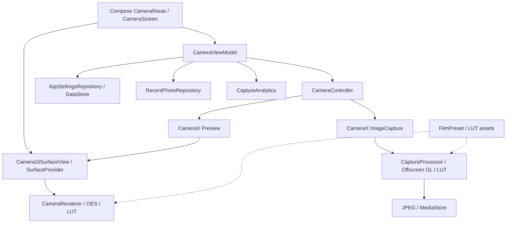

# 아키텍처와 선택의 이유

[프로젝트 소개로 돌아가기](../../README.md) · [이전: 회전과 배치](rotation-and-layout.md) · [다음: 검증 결과](validation.md)

> 현재 필요한 책임을 나누고, 복수 구현이나 재사용 요구가 생기는 지점에서 구조를 확장하는 방향을 택했습니다.

## 목차

- [전체 흐름](#전체-흐름)
- [책임과 기술 선택](#책임과-기술-선택)
- [단일 모듈과 필요한 인터페이스](#단일-모듈과-필요한-인터페이스)
- [코루틴과 전용 GL 스레드를 함께 쓴 이유](#코루틴과-전용-gl-스레드를-함께-쓴-이유)
- [배포 기능을 분리하는 방식](#배포-기능을-분리하는-방식)

## 전체 흐름



화살표는 주요 호출·데이터 흐름을 나타냅니다. 사진 처리와 프리뷰는 같은 필름 자산을 사용하지만 각각의 GL 자원을 소유합니다.

## 책임과 기술 선택

| 영역 | 선택 | 이유와 경계 |
| --- | --- | --- |
| UI | Kotlin·Jetpack Compose | 상태와 이벤트를 연결하고, Preview View를 포함하는 트리를 유지 |
| 카메라 | CameraX | Preview·ImageCapture·카메라 제어를 Controller에 모음 |
| 프리뷰 필터 | OpenGL ES 3.0·SurfaceTexture | 프레임을 직접 받아 실시간 LUT 적용을 구성하고 렌더링 과정을 학습 |
| 상태·비동기 | ViewModel·StateFlow·Coroutines | 촬영 상태, 설정 구독, 실패·취소 흐름 관리 |
| 객체 연결 | Hilt | ViewModel·Controller·Repository의 생성과 의존성 연결 |
| 설정 | Preferences DataStore | 시작 필름·격자·셔터음 설정 보존 |
| 사진 저장 | MediaStore | 사용자 기기의 사진 컬렉션에 JPEG 저장 |

이 프로젝트에서는 실시간 LUT 합성과 렌더링 학습을 위해 프리뷰 입력을 직접 다루는 경로를 선택했습니다. 그만큼 Surface 공급, GL 초기화와 해제, 회전 변환을 앱이 관리하는 비용을 감수했습니다. **(제품 요구에서 도출한 구현 결정)**

지원 하한은 API 29로 정했습니다. 프로젝트의 MediaStore 저장 흐름에서 이전 저장소 권한 분기를 추가하지 않는 선택이며, 구형 Android 지원 범위를 줄이는 비용이 있습니다. OpenGL ES 3.0과 후면 카메라도 실제 구현이 요구하는 하드웨어 조건으로 선언했습니다. [빌드 설정](../../app/build.gradle.kts) · [Manifest](../../app/src/main/AndroidManifest.xml)

## 단일 모듈과 필요한 인터페이스

[Android 아키텍처 가이드](https://developer.android.com/topic/architecture/recommendations)는 UI·data 책임 분리를 강하게 권장하면서, domain 계층은 여러 ViewModel에서 규칙을 재사용하거나 로직이 복잡해지는 큰 앱에 권장합니다. 패키지와 Gradle 모듈의 분리도 같은 문제가 아닙니다. 이 프로젝트에서는 권장 구조의 책임 구분을 적용하되, 현재 필요하지 않은 별도 domain 계층과 다중 모듈 구성은 도입하지 않았습니다.

현재는 단일 `:app` 모듈 안에서 `camera`, `camera/gl`, `camera/capture`, `camera/filter`, `ui`, `data`로 책임을 나눕니다. 촬영 흐름이 중심인 개인 프로젝트이고 다른 앱이 재사용할 대상이나 여러 ViewModel에 반복되는 비즈니스 규칙이 아직 없습니다. 지금 별도 `:domain`·`:data` Gradle 모듈을 만들면 빌드 그래프와 의존성 주입 경계를 관리해야 하지만, 확인된 프리뷰 생명주기·필터 일관성 문제를 직접 줄이지는 못합니다. **(구현 결정과 비용 비교)**

Repository에도 인터페이스를 일괄 추가하지 않았습니다. 구현이 하나인 계약을 그대로 복제하기보다, 실제로 교체할 구현이나 제어 가능한 테스트 대역이 필요할 때 해당 경계를 추출하기로 했습니다. ViewModel은 설정 저장소의 세부 API 대신 Repository를 사용합니다.

반면 `CaptureAnalytics`는 Firebase 구현과 설정 파일이 없는 Debug용 no-op 구현이 실제로 존재하므로 인터페이스를 둡니다. 같은 원칙을 적용하더라도 경계의 사용 목적에 따라 선택이 달라집니다.

| 현재 선택 | 재검토할 조건 |
| --- | --- |
| 단일 모듈과 패키지 경계 | 다른 앱의 재사용 요구, 빌드 시간·개발 경계의 실제 문제 |
| 설정·최근 사진 Repository 구현 주입 | 테스트용 fake나 로컬·원격 복수 구현이 필요해짐 |
| 별도 domain/use case 계층 보류 | 여러 ViewModel에 같은 규칙이 반복되거나 조합 로직이 복잡해짐 |
| 두 필름을 초기화 시 업로드 | 필름 수·해상도 증가로 초기화 시간이나 메모리 부담이 관찰됨 |

모듈을 나누지 않은 만큼 import 방향과 자원 소유권은 코드 리뷰로 지켜야 합니다. 클래스나 파일 수가 적다는 것만으로 구조가 적절하다고 판단하지 않습니다.

## 코루틴과 전용 GL 스레드를 함께 쓴 이유

촬영은 카메라 입력, 이미지 변환, GPU 처리, JPEG 인코딩, 저장으로 이어집니다. 여기서는 비동기 흐름을 표현하는 방법과 GL 작업을 실행할 스레드를 정하는 방법을 별도로 판단했습니다.

| 판단 주제 | 선택과 이유 | 감수한 책임 |
| --- | --- | --- |
| 비동기 처리 흐름 | CameraX의 suspend 촬영 경로와 ViewModel의 `try/catch/finally`로 순서·오류·취소·촬영 상태 복구를 한 흐름에서 다룹니다. 콜백을 단계마다 연결하면 복구 경로가 흩어질 수 있다는 제약을 고려했습니다. | 촬영 작업이 ViewModel 수명에 연결되므로, ViewModel이 정리된 뒤에도 저장을 완료해야 한다면 작업 수명을 다시 정해야 합니다. |
| GL 실행과 자원 관리 | `CaptureProcessor`가 단일 스레드 Executor를 CoroutineDispatcher로 감싸, offscreen EGL·GL 작업을 같은 물리 스레드에서 실행합니다. | 전용 Executor와 EGL Context의 종료·해제를 소유해야 합니다. |

코루틴을 사용한다는 사실만으로 GL 작업이 전용 스레드에서 실행되는 것은 아닙니다. 이 구현에서는 `captureDispatcher`가 실행 스레드를 정합니다. 취소는 다시 전파하고, 처리·저장 오류는 사용자 안내로 연결합니다. **(현재 구현 결정)**

```text
ViewModel의 촬영 작업
  → CameraController.takePhoto()
  → CameraX의 suspend 촬영
  → CaptureProcessor 전용 Dispatcher
  → 이미지 변환 / GL 필터 / JPEG / MediaStore
  → 성공 안내 또는 오류 안내 / 촬영 상태 복구
```

설정 화면으로 이동해도 카메라 destination이 back stack에 남아 있으면 ViewModel은 유지됩니다. 단순한 화면 이탈과 ViewModel 정리는 다릅니다. destination 제거로 ViewModel이 정리되거나 프로세스가 종료된 뒤에도 저장을 보장해야 한다면, 작업 수명과 원본 보존 방식을 다시 설계해야 합니다. **(현재 선택의 한계)**

관련 코드: [CameraViewModel](../../app/src/main/java/com/newfeelcamera/ui/camera/CameraViewModel.kt) · [CaptureProcessor](../../app/src/main/java/com/newfeelcamera/camera/capture/CaptureProcessor.kt) · [CaptureEglSession](../../app/src/main/java/com/newfeelcamera/camera/capture/CaptureEglSession.kt)

## 배포 기능을 분리하는 방식

v1 기본 빌드는 촬영·필터·설정 흐름에 집중합니다. Firebase SDK를 참조하는 소스와 no-op 소스를 분리하고, 이전 결제·무료 한도 구현은 기본 소스 집합에서 제외했습니다. Firebase 설정 파일이 없는 환경에서는 Debug 빌드가 no-op 구현을 사용하지만, Release 빌드는 설정 파일이 반드시 있어야 합니다.

Firebase 이벤트는 사진 저장 성공 뒤에 기록하도록 설계했고, 분석 기록 실패가 저장 성공을 실패로 바꾸지 않게 했습니다. Release에는 Firebase 구현을 포함하고, 사용자가 선택한 뒤에만 SDK를 초기화하고 이벤트를 전송합니다. 설정에서 선택을 변경할 수 있습니다. 실제 콘솔 수신 검증은 별도로 남겼습니다. **(현재 구현 / 후속 과제)**

근거 문서: [상세 아키텍처](../01-architecture.md) · [LUT 설계](../03-rendering-and-lut.md) · [Firebase 구성](../features/firebase-monitoring.md)
