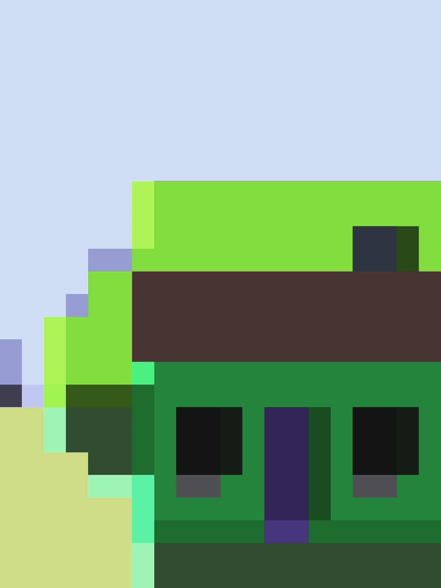

# 필터와 촬영 파이프라인

[프로젝트 소개로 돌아가기](../../README.md) · [이전: 개발 배경](product-and-development.md) · [다음: 프리뷰 생명주기](preview-lifecycle.md)

> 프리뷰와 사진 처리는 서로 다른 경로로 실행하되, 사용자가 고른 필름과 색보정 규칙을 함께 사용하도록 설계했습니다.

## 목차

- [해결하려던 문제](#해결하려던-문제)
- [LUT와 렌더링 방식을 정한 과정](#lut와-렌더링-방식을-정한-과정)
- [셔터 순간의 선택을 저장까지 유지하기](#셔터-순간의-선택을-저장까지-유지하기)
- [프리뷰와 촬영의 책임 나누기](#프리뷰와-촬영의-책임-나누기)
- [실제 저장 결과](#실제-저장-결과)
- [확인한 결과와 남은 질문](#확인한-결과와-남은-질문)

## 해결하려던 문제

사용자는 프리뷰의 색감을 보고 셔터를 누릅니다. 저장 사진에 다른 필름이 적용되거나, 처리 중 필름을 바꿨다는 이유로 촬영 결과까지 달라진다면 선택과 결과의 연결이 끊깁니다.

그래서 필터 구현보다 먼저 두 조건을 정했습니다. 프리뷰와 저장은 같은 필름 모델·LUT를 참조하고, 한 번 시작한 촬영은 셔터 시점의 필름을 유지합니다. 프리뷰와 사진의 픽셀 값이 완전히 동일해야 한다는 요구와는 구분했습니다. **(제품 요구사항 / 구현 결정)**

## LUT와 렌더링 방식을 정한 과정

LUT는 입력 색을 어떤 출력 색으로 바꿀지 정한 표입니다. 제공된 두 파일의 크기는 각각 98,304바이트이며, `32 × 32 × 32 × RGB 3바이트` 구조와 일치합니다. 파일과 셰이더를 함께 확인해 형식과 샘플링 방식을 정리했습니다. **(자산에서 확인한 사실)**

현재 셰이더가 `sampler3D`를 사용하므로 OpenGL ES 3.0의 3D 텍스처에 LUT를 올리는 방식을 채택했습니다. LUT 파일 자체가 모든 구현에서 3D 텍스처를 강제한다고 해석하지는 않았습니다. 제공된 구현 방식과 제품이 반드시 지켜야 할 조건을 나눠 판단한 사례입니다. **(구현 결정)**

WARM·DUSK는 각 GL Context를 초기화할 때 함께 업로드합니다. 필름 선택 때마다 파일을 다시 읽고 업로드하는 대신 준비된 텍스처를 바꿔 연결합니다. 두 LUT의 원본 데이터 합계는 196,608바이트이며, 이는 GPU 전체 메모리 측정값이 아닙니다. 필름 수나 LUT 해상도가 늘어나면 초기화 시간과 메모리를 측정해 이 방식을 재검토할 계획입니다.

## 셔터 순간의 선택을 저장까지 유지하기

현재 선택은 `CameraUiState.selectedFilm`에 있습니다. 셔터 입력을 받아들일 때 `filmAtShutter`로 보관하고, 이후 촬영과 필터 처리는 이 값을 전달받습니다.

```text
DUSK 선택 → 셔터 → DUSK를 촬영 입력으로 고정 → DUSK 적용 → JPEG 저장
                       │
                       └─ 처리 중 UI를 WARM으로 바꿔도 이번 사진은 DUSK 유지
```

화면 버튼과 볼륨 키는 같은 촬영 진입점을 사용합니다. 촬영 중 중복 입력을 제한하고, 성공·실패·취소 후에는 `finally`에서 촬영 상태를 복구합니다. **(현재 코드)**

관련 코드: [CameraViewModel](../../app/src/main/java/com/newfeelcamera/ui/camera/CameraViewModel.kt) · [FilmPreset](../../app/src/main/java/com/newfeelcamera/camera/filter/FilmPreset.kt)

## 프리뷰와 촬영의 책임 나누기

| 구분 | 프리뷰 | 저장 사진 |
| --- | --- | --- |
| 입력 | CameraX가 공급하는 OES 텍스처 | ImageCapture의 ImageProxy를 변환한 Bitmap |
| 실행 | GLSurfaceView의 렌더링 스레드 | 전용 스레드의 offscreen EGL Context |
| 출력 | 화면에 표시할 프레임 | 필터 처리 결과를 인코딩한 JPEG |
| 함께 쓰는 기준 | FilmPreset, LUT 자산, 색보정·샘플링 규칙 | FilmPreset, LUT 자산, 색보정·샘플링 규칙 |

프리뷰는 연속되는 프레임을, 촬영은 한 장의 고해상도 이미지를 처리합니다. 현재는 GL Context와 텍스처 ID를 공유하지 않고 각 경로가 자기 자원을 소유합니다. 입력 텍스처 종류가 달라 프래그먼트 셰이더 진입점도 나뉘어 있습니다. 공통 색보정 코드가 달라지지 않도록 두 셰이더를 함께 검토해야 한다는 비용은 남습니다. **(구현 결정과 비용)**

저장 경로는 이미지 변환 → GPU 필터 → 결과 읽기 → JPEG 인코딩 → MediaStore 공개 순서입니다. 저장을 끝내기 전에는 성공을 알리지 않으며, 촬영별 ImageProxy·Bitmap·GL 자원은 오류 경로에서도 해제하도록 책임을 정했습니다.

관련 코드: [CaptureProcessor](../../app/src/main/java/com/newfeelcamera/camera/capture/CaptureProcessor.kt) · [CaptureGlRenderer](../../app/src/main/java/com/newfeelcamera/camera/capture/CaptureGlRenderer.kt)

## 실제 저장 결과

<table>
  <tr><th>WARM 저장 JPEG</th><th>DUSK 저장 JPEG</th></tr>
  <tr>
    <td></td>
    <td></td>
  </tr>
</table>

2026-10-08, 앱 1.0.1 (2)의 에뮬레이터 촬영 결과입니다. 두 사진 모두 1392×1856이며, 문서에는 원본 JPEG를 사용했습니다. 같은 종류의 가상 장면을 각각 촬영한 자료로, 실물 색 정확도를 평가하는 기준 사진은 아닙니다. 촬영 직전 화면: [WARM](../assets/app/camera-warm.png) · [DUSK](../assets/app/camera-dusk.png)

## 확인한 결과와 남은 질문

기존 점검에서는 두 필름과 네 방향의 8개 조합에서 사진을 저장하고, 프리뷰와 결과의 장면·상대 색감을 확인했습니다. DUSK로 촬영을 시작한 직후 WARM으로 바꾼 경우에도 로그와 JPEG에는 DUSK가 유지됐습니다. **(2026-10-08 관찰 기록)**

2026-10-08에 개발자가 직접 실기기 검증을 완료했다고 확인했습니다. 이 완료 사실을 반영하되, 색 기준물·조명·8개 필름 및 방향 조합의 개별 결과는 [실기기 기록](validation.md#실기기-검증-완료)에 별도로 남깁니다. **(사용자 확인)**

다른 기기의 색공간·노출·JPEG 변환·GPU 정밀도에 따른 차이와 촬영 해상도별 최대 메모리·저장 지연은 검증 범위를 넓히며 측정할 과제입니다. 같은 LUT를 사용한다는 사실만으로 모든 환경의 색감 일치를 보장하지 않습니다. **(후속 측정)**

근거 문서: [렌더링·LUT 상세 설계](../03-rendering-and-lut.md) · [카메라 파이프라인](../02-camera-pipeline.md) · [검증 범위](validation.md)
