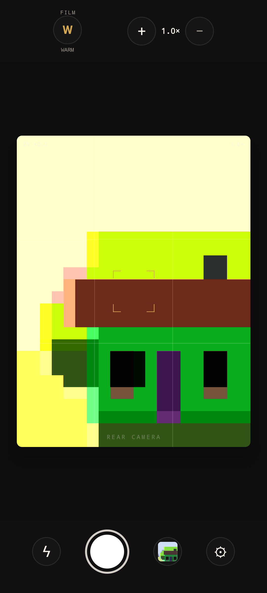
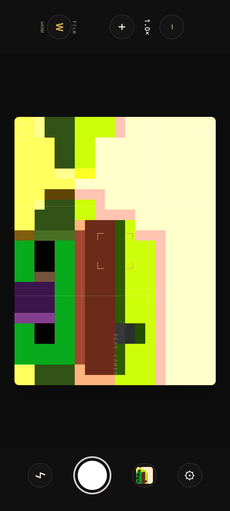
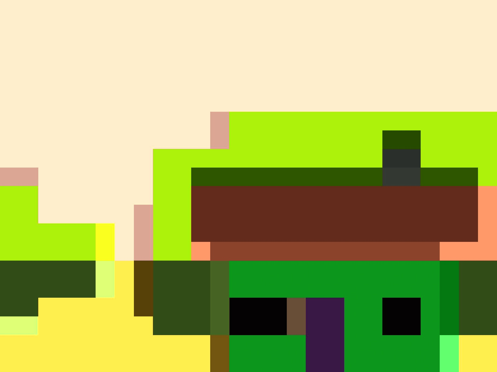

# 회전과 화면 배치

[프로젝트 소개로 돌아가기](../../README.md) · [이전: 프리뷰 생명주기](preview-lifecycle.md) · [다음: 아키텍처](architecture.md)

> Android 17의 큰 화면 방향 정책을 계기로 휴대폰과 큰 화면에 같은 고정 방향을 전제할 수 있는지 검토했습니다. 촬영 구도·컨트롤 위치·읽는 방향·저장 사진의 방향을 나눠 결정했습니다.

## 목차

- [만들고 싶었던 촬영 경험](#만들고-싶었던-촬영-경험)
- [세 가지 방향 신호 분리하기](#세-가지-방향-신호-분리하기)
- [실제 화면과 저장 사진](#실제-화면과-저장-사진)
- [큰 화면과 폴더블의 범위 정하기](#큰-화면과-폴더블의-범위-정하기)
- [검증과 후속 과제](#검증과-후속-과제)

## 만들고 싶었던 촬영 경험

[Android 17의 방향·크기 제한 변경](https://developer.android.com/about/versions/17/changes/ff-restrictions-ignored)에 따르면 API 37 이상을 대상으로 하는 앱은 최소 폭이 600dp를 초과하는 디스플레이에서 `screenOrientation` 등의 방향 요청이 무시됩니다. 이 앱도 `targetSdk = 37`이므로, 큰 화면에서 세로 고정이 적용된다는 전제로 카메라 UI를 만들 수 없었습니다. **(플랫폼 조건 / 현재 빌드 설정)**

처음에는 휴대폰에서도 방향 고정을 풀고 화면이 돌아갈 때마다 같은 적응형 배치를 적용하는 방안을 고민했습니다. 그러나 초기 `Column`·`Row` 구조 전환에서 Preview View가 다시 만들어지며 눈에 띄는 영상 공백을 관찰했습니다. 이후 고정된 `Box` 트리로 View의 호출 위치를 유지했지만, 휴대폰 창이 실제로 회전하면 전체 화면 재측정과 컨트롤 재배치가 남습니다. 촬영 중인 사용자의 구도와 셔터 위치를 안정적으로 유지할 필요가 더 컸습니다. **(초기 관찰과 UX 판단)**

현재 휴대폰에는 Activity 공통으로 **세로 방향을 요청**합니다. 창이 유지되는 동안 프리뷰 영역과 상·하단 컨트롤은 앱 좌표상 같은 위치에 두고, 글자와 아이콘처럼 읽는 방향이 있는 콘텐츠만 기기 방향을 따라 회전합니다. 가로 사진도 찍을 수 있도록 저장 방향은 물리적 기기 방향에서 따로 결정합니다. 설정 화면도 같은 Activity의 방향 요청을 유지해 화면 이동만으로 창의 축이 바뀌지 않게 했습니다. [Manifest의 방향 요청](../../app/src/main/AndroidManifest.xml) · [실제 배치](../../app/src/main/java/com/newfeelcamera/ui/camera/CameraScreen.kt)

세로 요청은 프리뷰 자원이 절대 재생성되지 않는다는 보장이 아니라 **휴대폰 촬영 UX를 위한 정책**입니다. 요청이 무시되거나 창 크기가 달라지는 큰 화면·멀티윈도우에서는 실제 창을 측정해 배치를 바꿉니다. Android 17의 조건만으로 모든 태블릿·폴더블이 동일하게 회전한다고 가정하지 않습니다. **(현재 구현 범위)**

## 세 가지 방향 신호 분리하기

| 입력 | 무엇을 결정하는가 | 나눈 이유 |
| --- | --- | --- |
| 실제 창의 너비·높이 | 세로·가로 레이아웃 모드 | 분할 화면이나 창 크기 변경은 물리적 회전과 다름 |
| Display rotation | 프리뷰 좌표계와 `Preview.targetRotation` | 화면에 표시되는 영상은 현재 Display 기준이어야 함 |
| 양자화한 기기 방향 | `ImageCapture.targetRotation`과 콘텐츠 회전 | 창이 세로로 유지돼도 가로 사진 촬영은 가능해야 함 |

아이콘의 화면상 회전은 기기 방향과 Display 방향의 차이를 반영합니다. 창 자체가 회전한 경우와 세로로 유지된 경우에 같은 각도를 무조건 더하지 않도록 했습니다.

GL 프리뷰에서는 SurfaceTexture 변환, CameraX 변환 정보, 화면 비율과 회전 보정을 다룹니다. UI 배치를 바꾸는 코드가 사진의 저장 방향까지 결정하지 않도록 책임을 나눴습니다. **(현재 구현)**

관련 코드: [CameraRoute](../../app/src/main/java/com/newfeelcamera/ui/camera/CameraRoute.kt) · [CameraScreen](../../app/src/main/java/com/newfeelcamera/ui/camera/CameraScreen.kt) · [PreviewTextureTransform](../../app/src/main/java/com/newfeelcamera/camera/gl/PreviewTextureTransform.kt)

## 실제 화면과 저장 사진

<table>
  <tr><th>0° 입력의 앱 화면</th><th>90° 입력의 앱 화면</th></tr>
  <tr>
    <td></td>
    <td></td>
  </tr>
</table>

90° 화면은 에뮬레이터 센서 입력을 바꾼 뒤의 캡처를 그대로 사용했습니다. 문서에서 이미지를 가로로 돌려 연출하지 않았으므로, 두 화면 모두 세로 캡처 형태로 보입니다.

같은 90° 촬영의 JPEG는 1856×1392 가로 이미지로 저장됐습니다. 위 자료는 2026-10-08, 앱 1.0.1 (2)의 에뮬레이터 기록입니다. 실기기 센서를 검증한 자료는 아닙니다. [이미지 출처](../assets/app/README.md)

## 큰 화면과 폴더블의 범위 정하기

초기 설계에서는 Tabletop·Book 모드와 힌지 위치 타입까지 미리 만들려 했습니다. 그러나 실제 자세 이벤트와 필요한 UI를 확인하기 전이어서, 추측한 형태를 구조에 고정하는 문제가 있었습니다.

현재 `CameraLayoutMode`는 실제로 측정된 창의 너비와 높이로 Portrait·Landscape를 고릅니다. 같은 `Box` 트리 안에서 프리뷰의 호출 위치를 유지하며, 사용 가능한 공간에 맞춰 컨트롤 레일과 프리뷰 크기를 조정합니다. 이는 방향 요청이 적용되지 않는 화면에서도 배치가 바뀔 수 있도록 한 경로입니다. [모드 판정 코드](../../app/src/main/java/com/newfeelcamera/ui/camera/layout/CameraLayoutMode.kt)

추가 모드는 요구와 관찰 결과가 생길 때 확장하기로 했습니다. 현재는 폴더블의 힌지·Tabletop·Book 자세를 구독하거나 그 자세별 UI를 제공하지 않습니다. **창 크기 대응을 구현한 것과 폴더블 자세별 경험을 완성한 것은 구분합니다.** **(범위 조정)**

custom Compose Layout도 처음부터 필수로 정하지 않았습니다. 실제로 확인된 Preview 재생성 문제에 맞춰 고정된 트리와 배치 조정 방식을 적용했습니다. 필요한 배치와 자원 수명 문제를 확인한 뒤 도구를 선택하려고 했습니다.

관련 코드: [CameraLayoutMode](../../app/src/main/java/com/newfeelcamera/ui/camera/layout/CameraLayoutMode.kt)

## 검증과 후속 과제

2026-09-23의 폴드 에뮬레이터 기록에서는 네 Display 방향을 왕복하는 동안 Surface 요청·GL 스레드·Context 세대가 유지됐고, 생명주기 7개와 회전·비율 5개 테스트가 통과했습니다. **(당시 관찰 기록)**

2026-10-08의 점검에서는 센서 입력으로 네 방향을 만들고 WARM·DUSK의 8개 JPEG를 확인했습니다. 0°·180°는 1392×1856, 90°·270°는 1856×1392였으며 방향은 사진 픽셀에 반영됐습니다. **(당시 관찰 기록)**

Activity 공통 세로 요청을 복원한 뒤에는 휴대폰 에뮬레이터에서 물리적 90° 회전과 설정 화면 왕복 중 창이 `ROTATION_0`을 유지하고 프리뷰가 다시 표시되는 것을 확인했습니다. 같은 수정본의 폴드 에뮬레이터는 연결되지 않아 **큰 화면에서 방향 요청이 무시되는 경로를 이때 다시 검증하지 못했습니다.** 앞선 폴드 점검과 현재 정책의 검증 범위를 나눠 봅니다. [구현·관찰 순서](../06-implementation-roadmap.md#step-15--settings-navigation과-phone-activity-portrait-유지)

직접 확인한 실기기 환경은 [검증 기록](validation.md#실기기-확인-환경)에 정리했습니다.

다른 기기에서의 회전 과도기·분할 화면·폴더블 힌지 자세는 검증 범위를 확대할 과제입니다. 두 실기기에서 확인한 결과나 과거 폴드 에뮬레이터 통과 기록을 모든 화면 크기의 검증으로 확대하지 않습니다.

근거 문서: [적응형 레이아웃 설계](../04-adaptive-layout.md) · [회전 구현과 검증 이력](../06-implementation-roadmap.md) · [회전 테스트 코드](../../app/src/androidTest/java/com/newfeelcamera/camera/gl/PreviewRotationTest.kt)
